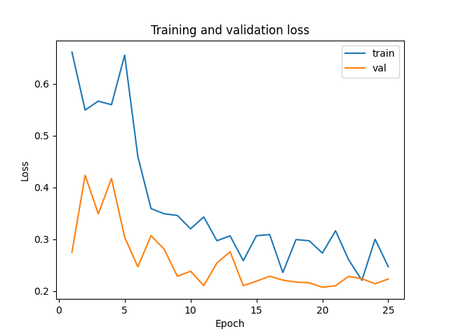
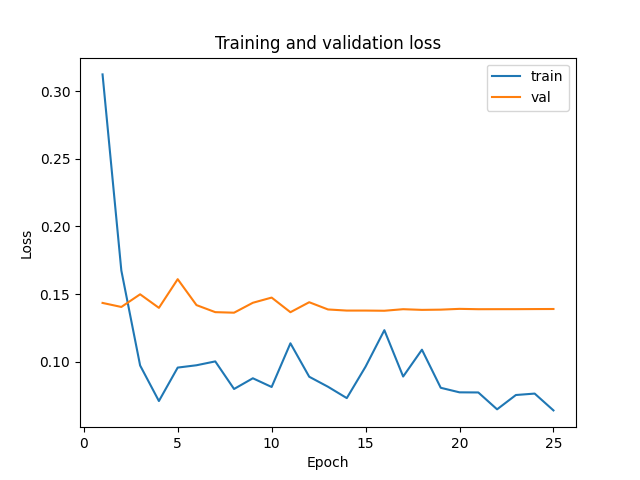
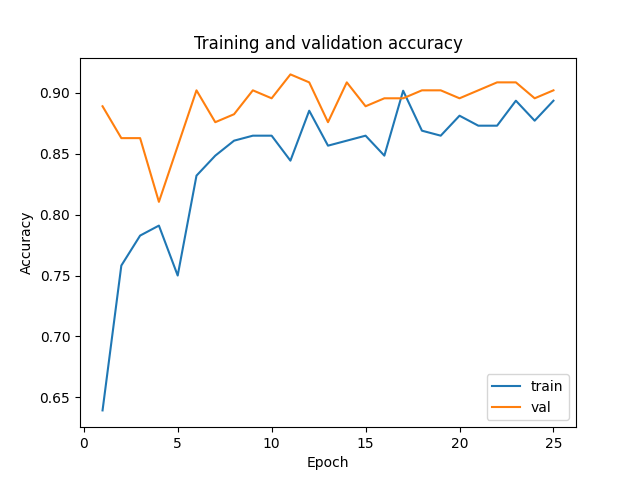
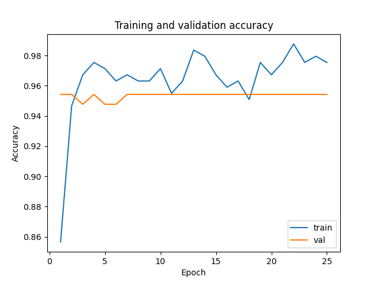
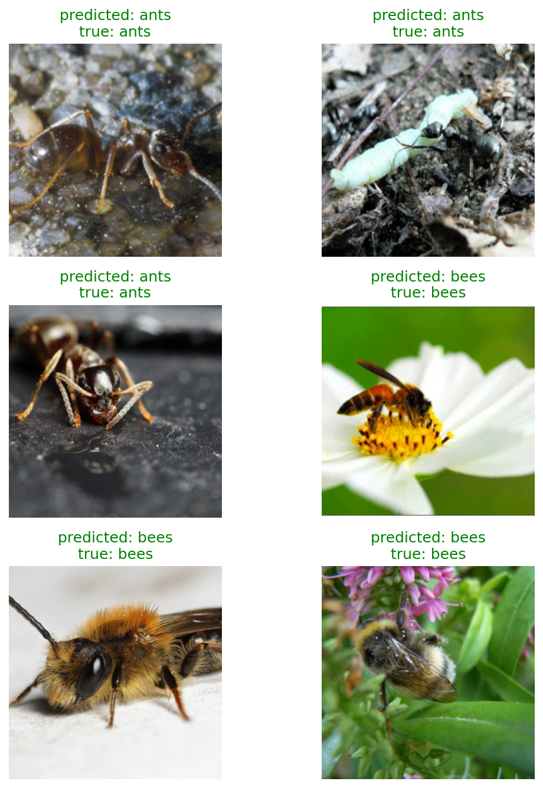

# ImageClassification：ResNet18 迁移学习练习

使用 ImageNet 预训练的 ResNet18，对蚂蚁（ants）和蜜蜂（bees）图片进行二分类。本项目记录从教程学习、修改代码，到比较全模型微调与冻结主干的过程。

## 来源与完成的工作

训练流程以 PyTorch 官方 [Transfer Learning for Computer Vision Tutorial](https://docs.pytorch.org/tutorials/beginner/transfer_learning_tutorial.html) 为基础。预训练 ResNet18 来自 torchvision；图片使用该教程提供的 [Hymenoptera 数据集](https://download.pytorch.org/tutorial/hymenoptera_data.zip)。模型结构和基础训练方法并非本项目原创。

在学习过程中，在教程基础上完成了以下调整：

- 根据脚本位置查找数据，避免运行目录变化导致找不到图片。
- 将最佳模型权重从临时目录改为永久保存。
- 验证集保持固定顺序；只在训练阶段清空梯度，统计预测结果时直接使用标签张量。
- 每轮记录训练与验证损失、准确率，保存 CSV，并绘制两组曲线。
- 预测图片同时显示预测类别和真实类别，以绿色和红色区分正确与错误。
- 展示用验证样本按类别抽取，每类固定随机选 3 张。
- 设置基础随机种子，并完成一次全模型微调与冻结主干的对比观察。

## 文件与数据

```text
ImageClassification/
├── main.py                    # 创建模型、设置优化器、启动训练
├── load_data.py               # 数据预处理、加载与图片显示
├── train_model.py             # 训练、验证、记录与预测展示
├── data/hymenoptera_data/     # 解压后的数据，不提交到 Git
│   ├── train/
│   │   ├── ants/
│   │   └── bees/
│   └── val/
│       ├── ants/
│       └── bees/
└── outputs/                   # 手动归档的实验结果
    ├── finetune/              # 全模型微调：曲线、预测图与 CSV
    └── frozen/                # 冻结主干：曲线、预测图与 CSV
```

下载数据后，将 `hymenoptera_data` 文件夹放入本项目的 `data/` 下，不要额外嵌套一层同名文件夹。

本地按可识别图片扩展名统计，数据划分如下：

| 划分 | 蚂蚁 | 蜜蜂 | 合计 |
| --- | ---: | ---: | ---: |
| train | 123 | 121 | 244 |
| val | 70 | 83 | 153 |

当前训练集设置了 `drop_last=True`；本地 244 张训练图片能被批大小 4 整除，不会丢弃尾批。数据内容改变后，应重新核对实际参与统计的样本数。

## 环境与运行

需要 Python，以及相互兼容的 PyTorch、torchvision、NumPy、Matplotlib。当前代码使用 `torch.accelerator` 接口，所用 PyTorch 版本需要支持该接口。按自己的 CPU/CUDA 环境安装匹配的 torch 和 torchvision，再安装其余依赖：

```bash
python -m pip install numpy matplotlib
```

本次两组实验没有随结果归档 Python/依赖版本、硬件型号和终端耗时，因此这里不将当前机器的环境版本当作原实验环境。后续运行时，可在实际训练环境中用下面的命令记录版本，并补充 CPU/显卡型号：

```bash
python -c "import sys, torch, torchvision, numpy, matplotlib; print(sys.version); print('torch:', torch.__version__); print('torchvision:', torchvision.__version__); print('numpy:', numpy.__version__); print('matplotlib:', matplotlib.__version__)"
```

在仓库根目录运行：

```bash
python ImageClassification/main.py
```

首次运行需要联网下载 ResNet18 预训练权重。程序自动选择可用的计算设备，否则使用 CPU。只查看一批训练图片时运行：

```bash
python ImageClassification/load_data.py
```

当前代码处于**全模型微调**状态（主干参数未冻结，训练阶段使用 `model.train()`）。主要设置为：

| 项目 | 当前设置 |
| --- | --- |
| 模型与初始权重 | ResNet18 / IMAGENET1K_V1 |
| 分类层 | Linear(512, 2) |
| 训练轮数 | 25 |
| 批大小 / 加载进程数 | 4 / 4 |
| 损失函数 | CrossEntropyLoss |
| 优化器 | SGD，lr=0.001，momentum=0.9 |
| 学习率调度 | StepLR，每 7 轮乘以 0.1 |
| 基础随机种子 | Python、NumPy、PyTorch 均为 42 |
| 训练预处理 | 随机裁剪到 224×224、随机水平翻转、ImageNet 标准化 |
| 验证预处理 | Resize(256)、CenterCrop(224)、ImageNet 标准化 |

轮数、学习率在 `main.py` 中修改；批大小和加载进程数在 `load_data.py` 中修改。固定基础种子不等于完全确定性复现：当前仍使用多进程加载和 `cudnn.benchmark=True`，不同软件版本和硬件也可能产生差异。

## 切换两种训练方式

每组实验都应重新启动程序，从预训练权重开始，保持其他设置一致。

**冻结主干，只训练新分类层**：在 `main.py` 中先冻结参数，再替换分类层：

```python
for param in model_ft.parameters():
    param.requires_grad = False

num_ftrs = model_ft.fc.in_features
model_ft.fc = nn.Linear(num_ftrs, len(class_names))
```

在 `train_model.py` 的训练阶段使用：

```python
model.eval()
model.fc.train()
```

这使主干 BatchNorm 的运行统计量保持不变，新分类层继续计算梯度和更新参数。验证阶段整个模型使用 `model.eval()`。

**微调整个模型（当前状态）**：将上述冻结参数的循环注释掉，并将训练阶段切回：

```python
model.train()
```

验证阶段仍保持 `model.eval()`。两处需要一起切换。

程序将以下文件保存到 `ImageClassification/`，**不会自动写入 `outputs/` 的分组目录**：

| 文件 | 内容 |
| --- | --- |
| best_model_params.pt | 最佳验证准确率对应的模型参数 |
| training_history.csv | 每轮训练与验证的损失、准确率 |
| loss_curve.png | 损失曲线 |
| accuracy_curve.png | 准确率曲线 |
| prediction_results.png | 最佳模型的验证样本预测展示 |

同名文件会被下一次运行覆盖。运行结束后手动将结果复制到 `outputs/finetune/` 或 `outputs/frozen/`，同时记录训练设置和终端显示的耗时。权重仅包含参数，不包含优化器和随机数状态，不能直接用于精确断点续训。仓库的 `.gitignore` 已忽略 `*.pt`，数据也不随代码上传。

## 小报告：冻结前后的结果比较

### 目的与证据

比较“微调整个 ResNet18”和“冻结主干参数及 BatchNorm 统计量、只训练分类层”在当前二分类任务上的表现。

本报告依据 `outputs/finetune/`、`outputs/frozen/` 中的六张图片，以及两组原始记录：[微调组 CSV](outputs/finetune/training_history.csv)、[冻结组 CSV](outputs/frozen/training_history.csv)。两组均记录了完整的 25 轮；表中数值由 CSV 计算，不再使用旧版图片的读图估计。当前微调组图片与 CSV 已替换为新一轮结果，本报告以当前归档为准。

上表列出的是当前代码设置。两组没有分别保存完整配置和环境快照，因此不能逐项确认历史运行的软件、硬件和随机设置完全相同。

### 数值与曲线

| 指标 | 全模型微调 | 冻结主干 |
| --- | ---: | ---: |
| 最佳验证准确率 | 91.50%（140/153） | 95.42%（146/153） |
| 首次达到最佳验证准确率的轮次 | 第 11 轮 | 第 1 轮 |
| 第 25 轮验证准确率 | 90.20% | 95.42% |
| 第 25 轮训练准确率 | 89.34% | 97.54% |
| 第 25 轮训练损失 | 0.2472 | 0.0641 |
| 第 25 轮验证损失 | 0.2235 | 0.1390 |
| 最低验证损失 | 0.2075（第 20 轮） | 0.1363（第 8 轮） |
| 总训练时间 | 未归档 | 未归档 |

以未四舍五入的 CSV 数值计算，冻结组最佳验证准确率比微调组高 **3.92 个百分点**，在相同的 153 张验证图片上多预测正确 6 张。这描述的是两组各自最佳模型的正确数量差异，不表示冻结模型恰好纠正了微调模型的 6 个错误；要判断具体哪些图片发生变化，还需要逐张预测记录。

**损失曲线**：微调组训练损失从第 1 轮的 0.6609 降至第 25 轮的 0.2472，前期波动明显，第 5 轮附近再次出现高点，后期有所下降但仍有波动。其验证损失最低为 0.2075，最后一轮为 0.2235。冻结组训练损失从 0.3123 降至 0.0641；验证损失基本维持在 0.14 附近，最低为第 8 轮的 0.1363。当前归档中，冻结组验证损失整体更低、更平稳。

| 全模型微调 | 冻结主干 |
| --- | --- |
|  |  |

**准确率曲线**：微调组验证准确率在 81.05%～91.50% 之间变化，第 11 轮首次达到最高值，最后一轮为 90.20%。冻结组第 1 轮已达到 95.42%，中间少数轮次降到 94.77%，第 7～25 轮均为 95.42%。冻结组后期训练准确率仍有变化，但验证准确率已进入平台期；准确率持平只代表正确数量相同，不代表每一轮错的都是同一批图片。

| 全模型微调 | 冻结主干 |
| --- | --- |
|  |  |

代码只在验证准确率严格提高时覆盖最佳权重。因此，按当前保存规则，微调组应保留第 11 轮权重，冻结组应保留第 1 轮权重；两组都不是按最低验证损失或最后一轮选择模型。归档中的预测图用于展示选出的最佳模型，而训练曲线覆盖全部 25 轮。

训练和验证使用不同预处理、模式，且训练指标是在参数不断更新时累计的，所以不能单凭“验证准确率高于训练准确率”判断程序有错，也不能仅凭曲线就认定出现了严重过拟合。

### 预测图片观察

两组预测图现在使用相同的 6 张图片：3 张蚂蚁、3 张蜜蜂，均预测正确。与旧版微调图只展示蚂蚁相比，现在可以直接对照相同样本，并观察两个类别的展示结果。不过，这 6 张图片没有体现两组模型的性能差距，也不能由“6/6 正确”推断整体验证准确率为 100%。

| 全模型微调：每类 3 张 | 冻结主干：相同的 6 张图片 |
| --- | --- |
|  |  |

当前没有归档错误案例展示。按最佳验证准确率计算，微调组在 153 张验证图片中有 13 张预测错误，冻结组有 7 张。后续可以分别收集错误图片，观察背景、拍摄角度或主体大小等可能造成混淆的因素。

### 结论与局限

这一次运行中，冻结主干取得了更高且更稳定的验证准确率，验证损失也更低。这与“ImageNet 预训练特征已经适合当前任务，只训练分类层即可有效分类”的解释相符，但仅凭这次结果不能确认差异全部由冻结造成。

两组已保存 CSV 和相同展示样本，但仍未进行多随机种子的重复实验，也没有分别归档环境、完整配置及可核对的耗时。因此不能声称冻结方式总是更好，或给出实际加速倍数。若继续实验，优先补充环境信息、配置快照、耗时，以及两组模型的错误样本。

本项目只有训练集和验证集，并使用验证集选择最佳权重。以上结果均为**验证准确率**，不代表独立测试集准确率。
